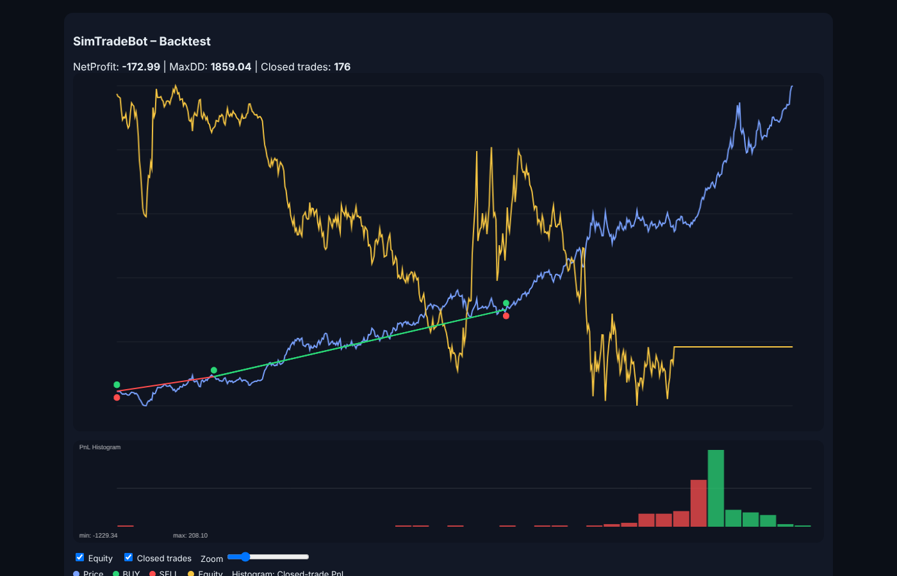

# Peter Samy – Computer Engineering Portfolio

M.Sc. student in **Computer Engineering** (Civilingenjör i datateknik, 300 ECTS) at **Mid Sweden University** (Mittuniversitetet), Sundsvall.

This repository collects the projects and lab work from my studies, organised so that each project can be read, built and run on its own.

**Languages & tools:** C++20 · C/C++ for microcontrollers (Mbed, LPC1768) · PHP · MySQL / SQL · JavaScript · HTML/CSS · CMake · Doxygen · Git

---

## Projects

| Project | What it is | Tech |
|---|---|---|
| [**SimTradeBot**](projects/simtradebot) | Backtesting framework for algorithmic trading strategies: CSV market data, risk management, grid-search optimisation, walk-forward validation and an interactive HTML chart. | C++20, CMake, fmt, Doxygen, unit tests |
| [**SmartBudget**](projects/smartbudget) | Full-stack web app for personal budgeting with login, admin panel, statistics and live data from the World Bank and Riksbank APIs. | PHP, MySQL (PDO), JavaScript, Chart.js |
| [**Tilt Maze**](projects/tilt-maze) | Embedded game: tilt the board to steer a ball to the goal before time runs out. Uses accelerometer, ADC, LCD, PWM sound and LEDs. | C++, Mbed, LPC1768 |

<p align="center">
  
  <br><em>SimTradeBot – backtest on historical gold prices (1793 onwards)</em>
</p>

---

## Coursework

| Course | Content |
|---|---|
| [ET095G – Introduction to Embedded Systems Programming](coursework/ET095G-inbyggda-system) | 4 labs on an LPC1768: LCD graphics, joystick, DAC waveforms, PWM, ADC, interrupts, timers, I²C and file logging |
| [Databases – modelling and implementation](coursework/databaser) | ER modelling, SQL schema and queries for a video-rental database, normalisation to 1NF–3NF |

---

## Repository structure

```
.
├── projects/
│   ├── simtradebot/      C++ backtesting framework
│   ├── smartbudget/      PHP/MySQL web application
│   └── tilt-maze/        Embedded game (Mbed LPC1768)
└── coursework/
    ├── ET095G-inbyggda-system/
    └── databaser/
```

Code comments and reports are mostly in Swedish, as the courses were taught in Swedish.
