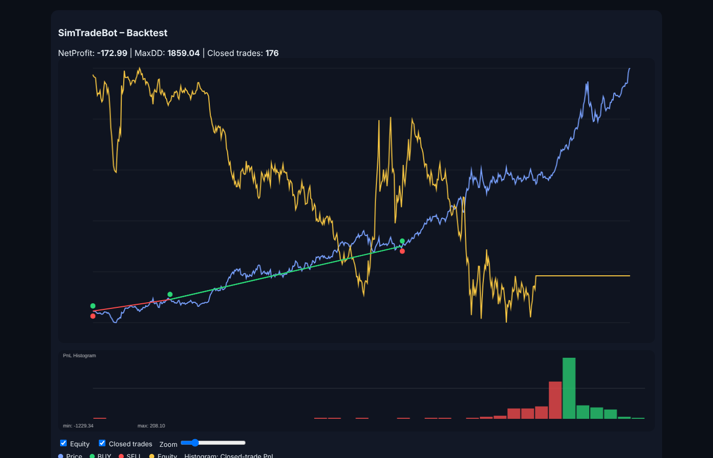

# SimTradeBot

A C++20 framework for **backtesting algorithmic trading strategies**. It replays historical price data, runs a strategy on each tick, simulates order execution under risk limits, and reports performance — both in the terminal and as an interactive HTML chart.

Built as a course project to practise object-oriented design, design patterns, external libraries, testing and documentation in a larger C++ codebase.



## Features

- **Market data** – CSV feed (`Date,Open,High,Low,Close`) that pushes ticks to subscribers (Observer pattern)
- **Strategies** – abstract `TradingStrategy` base class with a Mean Reversion implementation; new strategies plug in through `StrategyFactory`
- **Backtest engine** – signal handling, simulated execution, equity curve, trend/volatility regime filters
- **Risk management** – max trades, max position, drawdown stop, volatility-based position sizing
- **Performance metrics** – net profit, max drawdown, win rate, profit factor, Sharpe ratio, average win/loss
- **Optimisation** – grid search over strategy parameters
- **Walk-forward analysis** – train/test folds to check that parameters generalise out of sample
- **Visualisation** – self-contained HTML chart with price, equity curve, BUY/SELL markers and a PnL histogram ([example](examples/chart_gold.html))

## Architecture

```
include/simtrade/
├── core/      Types, Logger, Observable
├── data/      MarketDataFeed, CsvMarketDataFeed
├── trading/   TradingStrategy, MeanReversionStrategy, StrategyFactory,
│              BacktestEngine, ExecutionSimulator, RiskManager,
│              PerformanceAnalyzer, Optimizer, WalkForward
└── ui/        HtmlChartWriter, ReportWriter
src/           Implementations
tests/         Unit tests + sample data
extern/fmt/    {fmt} formatting library (header-only)
```

Design patterns used: **Strategy**, **Observer**, **Factory**; ownership via RAII and `std::unique_ptr`.

## Build and run

Requires a C++20 compiler and CMake ≥ 3.16.

```bash
cmake -S . -B build
cmake --build build
ctest --test-dir build --output-on-failure    # run unit tests

./build/simtrade_app tests/data/gold.csv      # writes out_chart.html
```

On Windows with MinGW, the included `makefile` also works: `make`, `make check`, `make run`.

### Example output (gold prices, 1793–2025)

```
=== Single Run ===
NetProfit: -172.985 | MaxDD: 1859.04 | ClosedTrades: 176 | WinRate: 71.0227%
PF: 0.975326 | Sharpe: 0.000129531 | AvgTrade: -0.982869 | AvgWin: 54.7033 | AvgLoss: -137.469

=== Walk Forward ===
Fold 0 best(w=100, th=0.02, q=1) | TrainPnL=244.15  | TestPnL=242.12  | TestPF=1.81
Fold 1 best(w=100, th=0.02, q=1) | TrainPnL=723.08  | TestPnL=1350.7  | TestPF=2.57
Fold 2 best(w=100, th=0.01, q=1) | TrainPnL=1159.81 | TestPnL=-605.345 | TestPF=0.64
```

The single run shows why walk-forward testing matters: a high win rate (71 %) can still lose money when losing trades are larger than winning ones.

## Documentation

All public classes are documented with Doxygen comments. Generate the HTML docs with:

```bash
doxygen Doxyfile
```

See also [docs/reflection.md](docs/reflection.md) for a reflection on design choices.

## Possible extensions

More strategies (momentum, breakout), SQLite persistence, a GUI (SFML/Qt), more advanced risk models.
